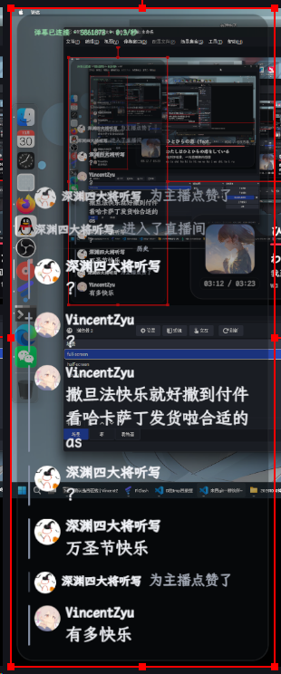

# 📺 Bili Live Danmaku

<p align="center">
  
</p>

把 B 站直播间弹幕渲染成适用于 OBS Browser Source 的透明聊天面板。Python 后端负责连接 B站、解析事件和缓存素材，本地 WebUI 负责控制台与画面渲染。

目前的开发和测试环境主要是 Windows 11 x64；项目按跨平台 PC 设计，其他平台尚未充分验证。

> [!TIP]
> 目前仍是初版，主要供自用阶段。欢迎通过 [Issue](https://github.com/VincentZyu233/bili-live-danmaku/issues) 或 PR 反馈问题、改进建议和功能需求。

> 项目参考并移植了 [zlinux-live-util/pw-live-danmaku](https://github.com/zlinux-live-util/pw-live-danmaku) 的协议结论和交互设计。上游的 `pw` 指 PipeWire；本项目使用 OBS 浏览器源，不需要 PipeWire。

## 🖼️ 预览



在 OBS 32.1.2 中作为浏览器源运行，右侧为透明圆角弹幕面板，支持真实头像、礼物、点赞、舰长、历史消息与 LXGW 字体。

## ✨ 功能

- 普通弹幕、头像、表情、礼物、入场、点赞、醒目留言和大航海卡片
- 礼物与入场按时间窗口合并
- 最近 N 行历史在重启后恢复，并与本次直播用分割线隔开
- 整块可配置圆角面板、透明度、边框、内边距、字号和颜色
- 支持系统已安装字体，以及上传 TTF/OTF/TTC/WOFF/WOFF2
- 内置 LXGW WenKai Mono Medium（SIL OFL 1.1），控制台和弹幕浮层默认统一使用霞鹜文楷
- OBS Browser Source 原生透明背景
- 本地 WebUI 实时预览、状态查看、Cookie 导入和演示消息
- Cookie 文件、`--cookie-file`、`--cookie` 三种凭据入口
- 断线自动重连；匿名模式仍可接收弹幕，但昵称可能被打码

## 🚀 启动

双击 `scripts/start-bili-live-danmaku.cmd` 可检查并启动 6161 服务；服务已运行时只会打开 WebUI。桌面快捷方式名称为 `Bili Live Danmaku`，关闭控制台窗口即可停止服务。

```powershell
uv sync
uv run bili-live-danmaku --room 5861873
```

命令会启动 `http://127.0.0.1:6161/admin` 并自动打开控制台。输入直播间号或直播地址后保存，即可开始连接。

也可以直接用 Cookie 文件启动：

```powershell
uv run bili-live-danmaku --room 5861873 --cookie-file "$env:LOCALAPPDATA\bili-live-danmaku\cookie.txt"
```

如果想要离线预览：

```powershell
uv run bili-live-danmaku --demo
```

## 🍪 获取 Cookie

独立助手会启动 Edge/Chrome 的临时 profile，等待扫码登录后读取 Cookie：

```powershell
uv run tools/get_bili_cookie.py
```

默认写入：

```text
%LOCALAPPDATA%\bili-live-danmaku\cookie.txt
```

也可以把已有 Cookie 粘贴到控制台的“手动粘贴 Cookie”，或选择 Cookie 文件后导入。Cookie 按上游方式以明文保存；不要提交到 Git、发到公开聊天或粘贴进 issue。

`--cookie` 直接传值会出现在本机进程参数中，程序会打印警告，日常推荐 `--cookie-file` 或控制台导入。

## 🎛️ 配置到 OBS

1. 启动 `bili-live-danmaku` 并保持窗口和本地服务运行。
2. 在 OBS 的“来源”中点击 `+`，选择 **浏览器**。
3. 名称可填 `B站弹幕`。
4. URL 填 `http://127.0.0.1:6161/overlay`。
5. 宽度先填 `480`，高度 `1080`；也可以在控制台修改画布尺寸后同步调整。
6. 勾选“使用自定义帧率”，建议填 `30`。
7. 背景不需要额外色键；页面本身是透明背景，只有圆角面板区域有可见底色。
8. 如果 OBS 不刷新，右键该来源选择“刷新页面”。

控制台中的“复制地址”和实时预览可用来确认字体、圆角、透明度和消息效果。

## ⌨️ 命令行

```text
--room ROOM             直播间号或地址
--cookie COOKIE         直接传入 Cookie，不推荐
--cookie-file PATH      从文件读取 Cookie
--data-dir PATH         覆盖应用数据目录
--port PORT             本地端口，默认 6161
--no-browser            不自动打开控制台
--demo                  循环发送演示消息
--verbose               详细日志
```

## 📁 数据位置

默认应用数据目录：

```text
%LOCALAPPDATA%\bili-live-danmaku\
```

其中包含 `config.json`、`cookie.txt`、`history/`、`fonts/` 和图片缓存。Cookie、历史和缓存不会提交到仓库。

## 🛠️ 开发

```powershell
uv sync
uv run ruff check .
uv run mypy src
uv run pytest -q
```

跨平台进程采样：

```powershell
uv run scripts/measure_processes.py --name python --name obs-browser-page --seconds 10
```

协议夹具和事件测试不访问真实直播间；实际直播测试需要可用的房间号和可选 Cookie。OBS 端到端检查需要手动添加 Browser Source。

性能会随 OBS Browser 版本、GPU 加速、画布尺寸和消息量变化。当前机器曾测得 5 个 OBS Browser 进程合计约 213 MB 工作集；本项目建议先按 30 FPS、`480x1080` 和 80 行上限运行，再根据 OBS 统计调整。

## 📄 License

MIT。上游来源与协议实现说明见 [LICENSE](LICENSE) 和 [NOTICE.md](NOTICE.md)。B站小电视与头像组合图标说明见
[src/bili_live_danmaku/static/assets/BILIBILI-LOGO-NOTICE.md](src/bili_live_danmaku/static/assets/BILIBILI-LOGO-NOTICE.md)。

内置字体为 LXGW WenKai Mono Medium，按 SIL Open Font License 1.1 分发；许可见
[src/bili_live_danmaku/static/fonts/OFL.txt](src/bili_live_danmaku/static/fonts/OFL.txt)。
